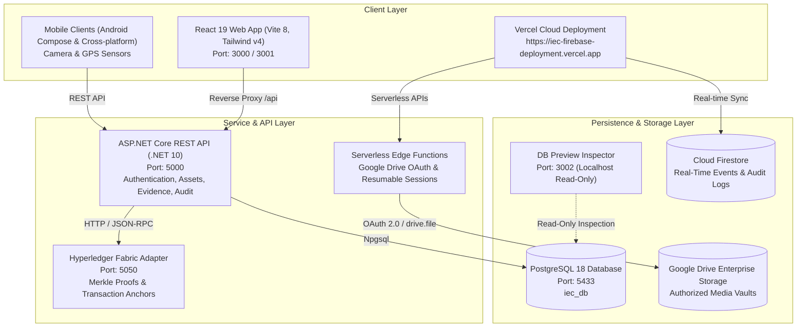
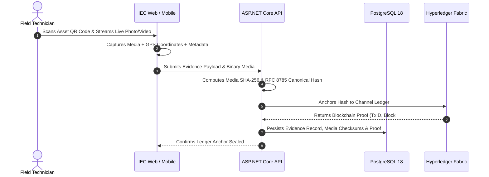

# Industrial Evidence Chain (IEC)

[](https://iec-firebase-deployment.vercel.app)
[](frontend/)
[](backend/)
[](database/)
[](blockchain/)
[](LICENSE)

An enterprise-grade, cryptographically verifiable, tamper-evident audit and evidence management platform designed for mission-critical industrial manufacturing, utility installations, and infrastructure plants.

🔗 **Live Production Application:** [https://iec-firebase-deployment.vercel.app](https://iec-firebase-deployment.vercel.app)

---

## 📌 Table of Contents

- [Overview & Core Problem Solved](#-overview--core-problem-solved)
- [System Architecture](#-system-architecture)
- [Key Features](#-key-features)
- [Role-Based Access Control (RBAC)](#-role-based-access-control-rbac)
- [Cryptographic Verification Pipeline](#-cryptographic-verification-pipeline)
- [Repository Structure](#-repository-structure)
- [Local Development Quickstart](#-local-development-quickstart)
  - [Prerequisites](#prerequisites)
  - [One-Command Environment Startup](#one-command-environment-startup)
  - [Default Test Credentials](#default-test-credentials)
- [Vercel & Cloud Deployment](#-vercel--cloud-deployment)
- [Security & Compliance Highlights](#-security--compliance-highlights)
- [Comprehensive Documentation](#-comprehensive-documentation)

---

## 🏭 Overview & Core Problem Solved

In high-stakes industrial operations (manufacturing plants, chemical processing units, energy grids, and refineries), equipment inspections, maintenance actions, and safety audits are routinely compromised by legacy tracking methods:

1. **Post-Incident Tampering:** Unsealed records can be modified retroactively in relational databases after a safety violation or equipment failure.
2. **Media Spoofing & Recycling:** Photos and videos submitted as proof of work are often selected from camera rolls, recycled from prior dates, or digitally manipulated.
3. **Location Fraud:** Unverified inspections ("ghost maintenance") are logged without technicians physically visiting physical machinery.
4. **Lack of Cryptographic Chain of Custody:** Traditional systems lack mathematical non-repudiation and immutable timestamp proofs.

**Industrial Evidence Chain solves these challenges** by enforcing real-time hardware camera and GPS capture, deterministic **RFC 8785 JSON Canonicalization Scheme (JCS)** payload hashing, and immutable anchoring on a **Hyperledger Fabric** blockchain ledger.

---

## 🏗 System Architecture



---

## ✨ Key Features

- **Direct Hardware Media Capture:** Real-time in-browser camera and video recorder enforcing live capture, preventing gallery reuse.
- **Geolocation & Timestamp Watermarking:** Cryptographic binding of GPS coordinates (`latitude`, `longitude`, `accuracy`) and server-synchronized ISO timestamps.
- **Deterministic Payload Hashing:** Canonical serialization according to **RFC 8785 (JCS)** and calculation of SHA-256 evidence digests.
- **Hyperledger Fabric Blockchain Proofs:** Merkle root and transaction ID generation creating mathematically immutable anchor seals.
- **Dynamic Manager Verification Queue:** Instant integrity verification with discrepancy detection (`INTEGRITY_MISMATCH`, `FILE_TAMPERED`, `STORAGE_ERROR`).
- **Auditor System Reports & CSV Export:** Compliance audit logs with mathematical metrics, advanced filtering, and RFC 4180 CSV export with formula injection neutralization (`=`, `+`, `-`, `@` escaping).
- **Interactive AI Support Assistant:** Role-aware virtual assistant powered by dynamic expression packs and reactive animated Memojis.
- **Google Drive Enterprise Storage:** Automatic subfolder provisioning (`Photo Evidence` & `Video Evidence`), Google Picker integration, and resilient chunked resumable upload sessions.

---

## 👥 Role-Based Access Control (RBAC)

The platform implements strict least-privilege role boundaries across all views and API operations:

| Role | Responsibilities | Key Permissions |
| :--- | :--- | :--- |
| **Technician** | On-site inspections, asset QR scanning, real-time photo/video evidence capture. | `evidence:create`, `qr:scan`, `assets:read` |
| **Manager** | Operational supervision, verification of technician evidence, operational actions. | `evidence:verify`, `assets:write`, `evidence:read` |
| **Auditor** | Independent compliance reviews, tamper analysis, immutable audit logs & CSV exports. | `audit:read`, `evidence:read`, `reports:export` |
| **Admin** | User approval workflow, role assignments, system settings, storage integrations. | `admin:users`, `admin:settings`, `admin:all` |

---

## 🔒 Cryptographic Verification Pipeline



---

## 📂 Repository Structure

```
Industrial-Evidence-Chain/
├── frontend/                  # React 19 + TypeScript + Vite 8 Web Client
│   ├── src/app/              # Application routing & providers
│   ├── src/components/       # UI components, layout, camera, QR, widgets
│   ├── src/pages/            # Role dashboards, verification, evidence capture
│   └── src/services/         # API services, Auth, Evidence, Assets
├── backend/                   # ASP.NET Core REST API (.NET 10)
│   ├── Controllers/          # AuthController, AssetsController, EvidenceController
│   ├── Data/                 # Entity Framework Core DbContext & DbInitializer
│   ├── Models/               # Domain entities (User, Asset, EvidenceRecord, Proof)
│   └── Services/             # Canonical hashing & business services
├── blockchain/                # Hyperledger Fabric Blockchain Adapter (Node.js)
│   ├── src/server.ts         # Fastify/Express microservice on port 5050
│   └── src/fabric/           # Fabric gateway & mock fallback engine
├── tools/db-preview/          # Isolated, read-only database inspector on port 3002
├── vercel-deployment/         # Independent Cloud Deployment (Vercel + Firebase + Google Drive)
│   ├── api-src/              # Serverless Google Drive OAuth & upload endpoints
│   ├── src/                  # Unified frontend with Firebase Firestore data sync
│   └── firestore.rules       # Hardened production Firestore security rules
├── docs/                      # Architectural specifications & handover manuals
├── start.sh / start.bat       # Single-command local environment launchers
└── stop.sh / stop.bat         # Clean service termination scripts
```

---

## 🚀 Local Development Quickstart

### Prerequisites

Ensure you have the following installed on your machine:
- [.NET 10.0 SDK](https://dotnet.microsoft.com/download)
- [Node.js 20+ & npm](https://nodejs.org/)
- [PostgreSQL 18](https://www.postgresql.org/) (Running on port `5433` with database `iec_db`)

### One-Command Environment Startup

Clone the repository and launch the complete stack with a single command:

```bash
# Clone the repository
git clone https://github.com/AshishShedge84/Industrial-Evidence-Chain.git
cd Industrial-Evidence-Chain

# Make scripts executable (macOS / Linux)
chmod +x start.sh stop.sh

# Start all 5 IEC development services
./start.sh
```

*(On Windows, run `start.bat`)*

The startup launcher validates the environment and launches:
- **Frontend Web Client:** [https://localhost:3000](https://localhost:3000) *(or port `3001`)*
- **Backend API:** [http://localhost:5000](http://localhost:5000)
- **Blockchain Adapter:** [http://localhost:5050](http://localhost:5050)
- **Database Preview:** [http://127.0.0.1:3002](http://127.0.0.1:3002)
- **PostgreSQL Database:** `localhost:5433`

To cleanly shut down all background services:
```bash
./stop.sh
```

---

### 🔑 Default Test Credentials

All local accounts share the default development password: **`password123`**

| Role | Username | Email | Password |
| :--- | :--- | :--- | :--- |
| **Admin** | `admin` | `admin@iec.app` | `password123` |
| **Technician** | `tech` | `bablu@iec.app` | `password123` |
| **Manager** | `manager` | `manager@iec.app` | `password123` |
| **Auditor** | `auditor` | `auditor@iec.app` | `password123` |

---

## ☁️ Vercel & Cloud Deployment

The `vercel-deployment/` directory contains an isolated, production-ready serverless build deployed at:
**[https://iec-firebase-deployment.vercel.app](https://iec-firebase-deployment.vercel.app)**

### Required Environment Variables for Cloud Deployment

Configure these in the Vercel Project Dashboard:

```ini
# Google Drive Enterprise Storage Integration
GOOGLE_DRIVE_CLIENT_ID=your_oauth_client_id.apps.googleusercontent.com
GOOGLE_DRIVE_CLIENT_SECRET=your_oauth_client_secret
GOOGLE_DRIVE_REDIRECT_URI=https://iec-firebase-deployment.vercel.app/api/integrations/google-drive/oauth/callback
GOOGLE_DRIVE_ROOT_FOLDER_ID=your_parent_folder_id
GOOGLE_DRIVE_PHOTO_FOLDER_ID=your_photo_folder_id
GOOGLE_DRIVE_VIDEO_FOLDER_ID=your_video_folder_id

# Cookie Encryption Secret (32+ characters)
DRIVE_SESSION_SECRET=your_random_secure_session_secret_passphrase
```

---

## 🛡 Security & Compliance Highlights

- **Zero Hardcoded Secrets (SEC-04):** No database passwords, JWT private keys, or OAuth secrets are stored in Git.
- **Cryptographic Canonicalization (RFC 8785):** Guarantees that key ordering and formatting differences do not compromise evidence checksum verification.
- **Formula Injection Mitigation:** All CSV report exports neutralize spreadsheet execution vulnerabilities (`=`, `+`, `-`, `@`, `\t`, `\r` prefixes).
- **Self-Healing Storage Cascade:** 4-tier configuration resolution (Runtime Memory → Encrypted Session Cookie → Firestore Document → Environment Variables) prevents serverless cold-start configuration loss.

---

## 📚 Comprehensive Documentation

Deep-dive architecture specifications and operations manuals are available in the [`docs/`](docs/) directory:

- [Complete Project Context & Architecture](docs/IEC_COMPLETE_PROJECT_CONTEXT.md)
- [API Reference Manual](docs/IEC_API_REFERENCE.md)
- [Complete File & Directory Structure](docs/IEC_COMPLETE_FILE_STRUCTURE.md)
- [Database Schema & Data Model](docs/IEC_DATABASE_AND_DATA_MODEL.md)
- [Workflows & RBAC Guide](docs/IEC_WORKFLOWS_AND_RBAC.md)
- [Setup & Operations Guide](docs/IEC_SETUP_AND_OPERATIONS.md)
- [Master Handover & Status Report](docs/IEC_MASTER_HANDOVER.md)

---

## 📜 License

This project is licensed under the MIT License — see the [LICENSE](LICENSE) file for details.
