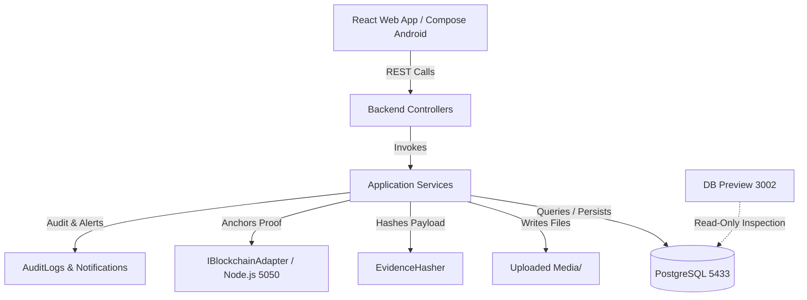

# Industrial Evidence Chain (IEC) — Complete Repository & File Structure Map

**Document Version:** 1.0.0  
**Audit Date:** October 2026  
**Audited Branch:** `Testing_prot-1`  
**Root Directory:** `/Users/ashishmac/Downloads/Projects/FYP GIT workspace/`  

---

## 1. Root Workspace Overview

The root workspace is an integrated multi-tier monorepo managing the ASP.NET Core backend, React web frontend, Node.js blockchain microservice, native Android Kotlin project, database configuration, media storage, diagnostic tools, and development automation scripts.

```text
/Users/ashishmac/Downloads/Projects/FYP GIT workspace/
├── APP DEV/                      # Mobile application projects (Android & iOS)
├── backend/                      # ASP.NET Core 10.0 Web API & EF Core models
├── blockchain/                   # Hyperledger Fabric chaincode, adapter & cryptography
├── database/                     # PostgreSQL authoritative SQL backup and scripts
├── db_data/                      # Permanent PostgreSQL 18 cluster data directory (pgdata)
├── docs/                         # Project architecture, source maps, and AI prompts
├── frontend/                     # React 19 + TypeScript + Tailwind CSS v4 web application
├── logs/                         # Runtime logs generated by background services
├── node_modules/                 # Root npm workspace dependencies
├── scripts/                      # Port checking and validation utilities
├── tests/                        # Backend xUnit test project
├── tools/                        # Diagnostic utilities (db-preview read-only web server)
├── Uploaded Media/               # Host filesystem directory for off-chain evidence photos/videos
├── .env.example                  # Environment variable template
├── .gitignore                    # Git ignore configuration
├── LAN_ACCESS.md                 # Local Wi-Fi / LAN multi-device access documentation
├── package.json                  # Root npm workspace orchestration script
├── package-lock.json             # Root npm lockfile
├── start.bat                     # Windows development launcher
├── start.sh                      # macOS / Linux development launcher
├── stop.bat                      # Windows service shutdown script
└── stop.sh                       # macOS / Linux service shutdown script
```

---

## 2. Root Files & Operational Scripts

| Path | Primary Responsibility | Dependencies & Callers | Workflow Position |
| :--- | :--- | :--- | :--- |
| `start.sh` | Main macOS/Linux startup script. Prompts for `DB_PASSWORD`, locates PostgreSQL 18 tools, starts PostgreSQL on port 5433, checks `iec_db` existence, builds & launches ASP.NET Core backend on port 5000, starts blockchain adapter on port 5050, starts DB preview on port 3002, starts Vite on port 3000, and runs health checks. | `pg_ctl`, `dotnet`, `node`, `npm`, `curl`, `lsof`. Executed by developer to start full environment. | **Step 0**: Environment Initialization. |
| `start.bat` | Main Windows startup script. Mirrors `start.sh` logic for Windows environments (`cmd.exe`). Enforces strict port 5433 and database `iec_db`. | Windows CLI, .NET SDK, Node.js, PostgreSQL tools. | **Step 0**: Windows Environment Initialization. |
| `stop.sh` | Cleanly stops listening services on ports 3000, 5000, 5050, 3002. Optionally stops PostgreSQL on port 5433 when passed `--with-db` or `--all`. | `lsof`, `kill`, `pg_ctl`. | Environment teardown. |
| `stop.bat` | Windows service termination script. Terminates PIDs listening on ports 3000, 5000, 5050, 3002 using `netstat` and `taskkill`. | Windows `taskkill`. | Environment teardown. |
| `LAN_ACCESS.md` | Guide for accessing IEC over local Wi-Fi from mobile phones, tablets, and secondary laptops. Documents IP discovery, firewall rules, and Vite proxy mechanics. | Read by developers during field mobile testing. | Setup & Network testing. |
| `package.json` | Root npm configuration defining workspaces (`frontend`, `blockchain`) and composite scripts (`npm run dev`, `npm run test:blockchain`, `npm run test:all`). | npm CLI. | Project-wide dependency management. |

---

## 3. Backend Architecture (`backend/`)

The backend is built with **ASP.NET Core 10.0** using C# 13, targeting PostgreSQL via **Entity Framework Core 9.0 (Npgsql)**.

```text
backend/
├── Controllers/                  # REST API controllers (routing, HTTP status codes, authorization)
│   ├── AdminController.cs        # User approval and system audit log endpoints
│   ├── AssetController.cs        # Asset CRUD, search, and lifecycle history endpoints
│   ├── AuthController.cs         # Login, registration, token refresh, and profile endpoints
│   ├── EvidenceController.cs     # Evidence capture, media upload, submit, verify, action endpoints
│   ├── MediaController.cs        # Authenticated/public media file streaming with byte-range support
│   ├── NotificationController.cs # In-app notification listing, unread count, and read status
│   └── UsersController.cs        # User profile self-update endpoint
├── Data/                         # EF Core database context, initializers, and migrations
│   ├── AppDbContext.cs           # Entity definitions, table mappings, foreign keys, and indexes
│   ├── DbInitializer.cs          # Database connectivity check, auto-migrations, and role/user seeding
│   └── Migrations/               # EF Core code-first migration snapshots
│       ├── 20260905132718_InitialCreate.cs
│       ├── 20260907120000_AddFileHashToEvidenceMedia.cs
│       ├── 20260907130000_AddRefreshTokenTable.cs
│       ├── 20260924043434_AddQrIdentifierAndNotifications.cs
│       └── AppDbContextModelSnapshot.cs
├── DTOs/                         # Data Transfer Objects for API request and response contracts
│   ├── Admin/                    # AdminAuditLogDto, UserDto, UpdateUserStatusDto
│   ├── Assets/                   # AssetDto, CreateAssetRequestDto, UpdateAssetRequestDto, AssetHistoryDto
│   ├── Auth/                     # LoginRequestDto, LoginResponseDto, RegisterRequestDto, RefreshTokenRequestDto
│   ├── Blockchain/               # AnchorEvidenceParams, AnchorEvidenceResult, VerifyEvidenceParams
│   ├── Common/                   # ApiResponse<T>, ErrorResponseDto, PagedResult<T>
│   ├── Evidence/                 # EvidenceDto, CreateEvidenceRequestDto, CanonicalEvidencePayload, EvidenceVerificationResponseDto, OperationalActionRequestDto
│   ├── Notifications/            # NotificationDto
│   └── Storage/                  # StoredFileResult
├── Exceptions/                   # Custom domain exceptions
│   ├── ConflictException.cs      # Maps to HTTP 409 Conflict
│   ├── NotFoundException.cs      # Maps to HTTP 404 Not Found
│   └── ValidationException.cs    # Maps to HTTP 400 Bad Request
├── Helpers/                      # Cryptographic utilities
│   └── PasswordHasher.cs         # PBKDF2 with HMAC-SHA256 password hashing and constant-time verification
├── Middleware/                   # HTTP pipeline middleware
│   └── GlobalExceptionHandler.cs # Centralized exception-to-RFC 7807 / ApiResponse error translation
├── Models/                       # Domain entities mapped to PostgreSQL tables
│   ├── AppRoles.cs               # Role name string constants (Admin, Manager, Technician, Auditor)
│   ├── Asset.cs                  # Assets entity (asset_code, qr_identifier, location, specifications)
│   ├── AuditLog.cs               # AuditLogs entity (action, entity_type, entity_id, details JSON)
│   ├── BlockchainProof.cs        # BlockchainProofs entity (transaction_id, evidence_hash, anchored_at)
│   ├── Enums/                    # ActivityType, AnchorStatus, AssetStatus, MediaFileType
│   ├── EvidenceMedia.cs          # EvidenceMedia entity (storage_url, file_hash, file_size_bytes)
│   ├── EvidenceRecord.cs         # EvidenceRecords entity (activity_type, coordinates, hash, status)
│   ├── Notification.cs           # Notifications entity (type, title, message, is_read, metadata)
│   ├── RefreshToken.cs           # RefreshTokens entity (token_hash, expires_at, revoked_at)
│   ├── Role.cs                   # Roles entity
│   ├── User.cs                   # Users entity (username, email, password_hash, is_active)
│   └── UserRole.cs               # UserRoles junction entity
├── Properties/                   # IDE launch configurations
│   └── launchSettings.json       # Profiles for local IIS/Kestrel execution
├── Services/                     # Business logic and external service implementations
│   ├── Interfaces/               # Service abstractions (IAuthService, IAssetService, IEvidenceService, etc.)
│   ├── AdminService.cs           # User listing and account activation logic
│   ├── AssetService.cs           # Asset search, QR identifier resolution, creation, and audit logging
│   ├── AuditLogService.cs        # Asynchronous audit log persistence
│   ├── AuthService.cs            # JWT generation, token refresh rotation, and profile updates
│   ├── EvidenceHasher.cs         # RFC 8785 JSON canonicalizer and SHA-256 evidence hasher
│   ├── EvidenceService.cs        # Evidence draft creation, media upload, anchoring, and verification
│   ├── LocalFileStorageService.cs# File streaming, disk writing to Uploaded Media, and binary SHA-256
│   ├── MockBlockchainAdapter.cs  # In-memory thread-safe ledger simulator for development
│   └── NotificationService.cs    # Notification creation, unread counting, and mark-as-read
├── Settings/                     # Strongly-typed configuration options
│   ├── FileStorageSettings.cs    # BasePath configuration ("../Uploaded Media")
│   └── JwtSettings.cs            # Secret, Issuer, Audience, ExpiryMinutes
├── appsettings.json              # Main configuration template
├── appsettings.Development.json  # Development overrides
├── appsettings.Development.local.json # Local connection overrides
├── backend.csproj                # MSBuild project file (.NET 10.0, Npgsql, EF Core, Swashbuckle)
└── Program.cs                    # Application entry point, DI registrations, CORS, JWT, middleware pipeline
```

### Detailed Component Analysis (Backend)

#### `Program.cs`
- **Responsibility:** Bootstraps ASP.NET Core web host. Enforces authoritative database parameters (`Host=localhost`, `Port=5433`, `Database=iec_db`), configures EF Core with Npgsql, configures JWT Bearer authentication, registers authorization policies (`RequireAdmin`, `RequireManager`, `RequireTechnician`, `RequireAuditor`, `RequireEvidenceCreator`), sets up LAN CORS allowing RFC 1918 private subnets, mounts static files for `/uploads`, registers Swagger UI, and runs `DbInitializer.SeedAsync`.
- **Called by:** .NET runtime on application boot.
- **Dependencies:** `AppDbContext`, all service interfaces, `JwtSettings`, `FileStorageSettings`.

#### `Controllers/EvidenceController.cs`
- **Responsibility:** Exposes REST endpoints for the full evidence lifecycle: `POST /api/evidence` (create draft), `GET /api/evidence` (paginated list scoped by role), `GET /api/evidence/{id}` (detail with masked hash for technicians), `POST /api/evidence/{id}/media` (multipart upload), `POST /api/evidence/{id}/submit` (seal and anchor), `GET /api/evidence/{id}/verification` (proof status), `POST /api/evidence/{id}/verify` (cryptographic verification trigger), and `POST /api/evidence/{id}/action` (operational decision logging).
- **Dependencies:** `IEvidenceService`.

#### `Services/EvidenceService.cs`
- **Responsibility:** Orchestrates evidence business logic. Validates assets and GPS coordinates, creates draft records, attaches media, gathers binary file hashes, invokes `IEvidenceHasher` to compute the canonical SHA-256 digest, calls `IBlockchainAdapter` to anchor proofs, recalculates live hashes from disk during verification, and records operational actions in `audit_logs`.
- **Dependencies:** `AppDbContext`, `IEvidenceHasher`, `IAuditLogService`, `IFileStorageService`, `INotificationService`, `IBlockchainAdapter`.

#### `Services/EvidenceHasher.cs`
- **Responsibility:** Implements **RFC 8785 JSON Canonicalization Scheme (JCS)**. Sorts JSON keys lexicographically by UTF-16 code units, normalizes coordinates to 6 decimal places, normalizes strings using Unicode Normalization Form C (NFC), formats timestamps as UTC ISO-8601 with milliseconds (`yyyy-MM-ddTHH:mm:ss.fffZ`), and computes SHA-256 hashes.
- **Dependencies:** `CanonicalEvidencePayload`, `System.Security.Cryptography.SHA256`.

#### `Services/LocalFileStorageService.cs`
- **Responsibility:** Receives uploaded file streams, checks file sizes and extensions, creates date-partitioned directories (`Uploaded Media/2026/09/`), computes binary SHA-256 live during disk write, and returns a `StoredFileResult` with relative storage URL and file checksum.
- **Dependencies:** `FileStorageSettings`, `IFileStorageService`.

---

## 4. Frontend Architecture (`frontend/`)

The web frontend is a high-performance Single Page Application built with **React 19**, **TypeScript**, **Tailwind CSS v4**, and **Vite 8**.

```text
frontend/
├── certs/                        # Self-signed development SSL certificates with dynamic SAN IPs
│   ├── cert.conf
│   ├── dev.crt
│   ├── dev.csr
│   ├── dev.key
│   ├── iec-ca.crt
│   └── iec-ca.key
├── public/                       # Static public assets
│   ├── logo.png                  # Primary IEC branding logo
│   ├── logo-3d.png               # 3D badge variant
│   ├── favicon.svg               # Browser favicon
│   └── memojis/                  # Role-specific Memoji expression packs
│       ├── roles/                # Subdirectories: Technician, Manager, Auditor, Admin
│       │   ├── Technician/       # Hello.png, Hover.png, Idle.png, Thinking.png, Work done.png, Something wrong.png
│       │   ├── Manager/          # Hello.png, Hover.png, Idle.png, Thinking.png, Work done.png, Something is wrong.png
│       │   ├── Auditor/          # Expression images
│       │   └── Admin/            # Expression images
│       └── ...
├── src/                          # TypeScript application source code
│   ├── app/                      # Application entry points, routing, and provider composition
│   │   ├── App.tsx               # Root component rendering RouterProvider
│   │   ├── providers.tsx         # Composed context providers (Auth, App, Assistant)
│   │   └── routes.tsx            # React Router v7 route definitions and route guards
│   ├── components/               # Modular reusable UI components
│   │   ├── assets/               # AssetCard, AssetList, AssetFilter, AssetSpecificationsView
│   │   ├── assistant/            # AssistantLauncher, AssistantWindow, AssistantMemoji, MessageComposer
│   │   ├── auth/                 # ProtectedRoute (PublicRoute, ProtectedRoute, RoleRoute)
│   │   ├── camera/               # CameraViewfinder, PhotoCapture, VideoRecorder
│   │   ├── dashboard/            # StatCard, RecentActivityCard, RoleKPIWidgets
│   │   ├── evidence/             # EvidenceCard, EvidenceList, EvidenceAuditTrailModal, CryptographicProofBadge
│   │   ├── layout/               # AppLayout, Header, Sidebar, MobileNavigation, PageContainer
│   │   ├── notifications/        # NotificationCenter (slide-over panel, unread badge, filters)
│   │   ├── qr/                   # QRCodeDisplay (qrcode.react), QRScanner (html5-qrcode), QRScanResult
│   │   ├── ui/                   # Design system primitives: Button, Badge, Modal, Card, Input, Textarea, Toast
│   │   └── verification/         # VerificationActions, HashComparisonView, OperationalDecisionModal
│   ├── constants/                # Domain constants
│   │   ├── activityTypes.ts      # Activity type definitions, icons, and descriptions
│   │   ├── evidenceStatus.ts     # Verification status codes and badge color mappings
│   │   ├── roles.ts              # System roles (Technician, Manager, Auditor, Admin)
│   │   └── routes.ts             # Route URL constants
│   ├── context/                  # React Context providers
│   │   ├── AppContext.tsx        # Global UI state (theme, sidebar open/collapse)
│   │   ├── AssistantContext.tsx  # Interactive assistant state, active emotion, chat messages
│   │   └── AuthContext.tsx       # Authentication state, login, logout, token refresh, and user normalization
│   ├── hooks/                    # Custom React hooks
│   │   ├── useAssistant.ts       # Hook for interacting with assistant messages and Memoji emotions
│   │   ├── useAuth.ts            # Convenience hook for AuthContext
│   │   ├── useCamera.ts          # MediaDevices hook managing webcam/mobile camera stream and recording
│   │   ├── useGeolocation.ts     # Navigator.geolocation hook capturing coordinates and accuracy
│   │   ├── useMediaCapture.ts    # Canvas photo capture and MediaRecorder video capture
│   │   └── useNotifications.ts   # Polling, syncing, and filtering notifications
│   ├── pages/                    # Route-level page components
│   │   ├── admin/                # AdminDashboard, UserManagementPage, AuditLogPage
│   │   ├── assets/               # AssetCatalogPage, AssetDetailsPage, AssetHistoryPage, CreateAssetPage
│   │   ├── audit/                # AuditDashboardPage
│   │   ├── auditor/              # AuditorDashboard
│   │   ├── auth/                 # LoginPage, RegisterPage, PendingApprovalPage
│   │   ├── dashboard/            # DashboardPage (role-based router to specific dashboard)
│   │   ├── evidence/             # EvidenceListPage, EvidenceDetailsPage, EvidenceHistoryPage
│   │   ├── manager/              # ManagerDashboard
│   │   ├── profile/              # ProfilePage
│   │   ├── settings/             # SettingsPage
│   │   ├── system/               # NotFoundPage, UnauthorizedPage, SystemHealthPage
│   │   ├── technician/           # TechnicianDashboard, CaptureEvidencePage (7-step wizard)
│   │   └── verification/         # VerificationPage (Pending Verification & Previously Verified tabs)
│   ├── services/                 # Frontend API client and service layers
│   │   ├── admin/                # adminService.ts (user management and audit APIs)
│   │   ├── api/                  # apiClient.ts (Axios instance, interceptors, dynamic LAN proxy)
│   │   ├── assets/               # assetService.ts (getAssets, getAsset, createAsset, updateAsset)
│   │   ├── assistant/            # assistantService.ts, assistantIdentity.ts
│   │   ├── auth/                 # authService.ts (login, register, me, refresh, logout)
│   │   ├── evidence/             # evidenceService.ts (create, upload, submit, verify, action)
│   │   ├── notification/         # notificationService.ts (syncRealEvents, markAsRead)
│   │   └── verification/         # verificationService.ts
│   ├── styles/                   # CSS stylesheets
│   │   ├── animations.css        # Custom keyframe animations
│   │   └── globals.css           # Tailwind v4 theme, glassmorphism classes, font definitions
│   ├── types/                    # Domain TypeScript interface declarations
│   │   ├── api.ts                # ApiResponse<T>, ApiError, PagedResult<T>
│   │   ├── asset.ts              # Asset, AssetLocation, AssetSpecifications
│   │   ├── assistant.ts          # AssistantIdentity, AssistantEmotion, ChatMessage
│   │   ├── auth.ts               # User, UserRole, LoginRequest, AuthState
│   │   ├── evidence.ts           # EvidenceRecord, EvidenceMedia, EvidenceLocation, ActivityType
│   │   ├── notification.ts       # Notification, NotificationType
│   │   └── verification.ts       # VerificationResult, VerificationStatus
│   ├── utils/                    # Helper utility functions
│   │   ├── avatarResolver.ts     # Resolves Memoji avatar paths based on role and expression
│   │   ├── date.ts               # Date formatting (UTC, localized, time ago)
│   │   ├── format.ts             # String formatting, hash shortening, coordinate truncation
│   │   └── validation.ts         # Form validation rules
│   ├── App.css                   # Component-specific styles
│   ├── index.css                 # Base stylesheet
│   └── main.tsx                  # Application entry point rendering ReactDOM.createRoot
├── index.html                    # HTML document template with viewport and font preloads
├── package.json                  # Frontend npm package manifest
├── tsconfig.json                 # TypeScript compiler configuration with path aliases
└── vite.config.ts                # Vite configuration: dual-protocol gateway, HTTPS certs, reverse proxy
```

---

## 5. Blockchain & Cryptography Module (`blockchain/`)

The blockchain module provides the smart contract logic, RFC 8785 canonicalization, SHA-256 hashing, digital signatures, and mock Hyperledger Fabric gateway.

```text
blockchain/
├── experiments/                  # Performance and throughput benchmarking scripts
│   └── run-all-benchmarks.ts     # Microsecond-level hashing and verification benchmarks
├── network/                      # Live Hyperledger Fabric network configuration
│   ├── connection-profile.json   # Fabric gateway connection profile for Org1MSP
│   ├── docker-compose.yaml       # Fabric Orderer, Peer, and CA container definitions
│   └── start-network.ps1         # PowerShell deployment script for Fabric test network
├── scripts/                      # Demonstration scripts
│   ├── hashing-demo.ts           # Demonstrates deterministic hashing of evidence records
│   └── tamper-demonstration.ts   # Demonstrates cryptographic tamper detection on modified fields
├── src/                          # TypeScript source code
│   ├── adapter/                  # Blockchain adapter implementations
│   │   ├── factory.ts            # Factory selecting MockFabricAdapter vs live gateway
│   │   ├── IBlockchainAdapter.ts # Primary adapter interface contract
│   │   └── mockAdapter.ts        # Mock adapter with simulated latency and fault injection
│   ├── canonicalizer/            # RFC 8785 JSON Canonicalization Scheme (JCS)
│   │   ├── canonicalizer.ts      # Deterministic key sorting and NFC normalization
│   │   └── types.ts              # Canonical payload types
│   ├── chaincode/                # Hyperledger Fabric chaincode smart contract
│   │   ├── evidenceContract.ts   # EvidenceProofContract managing on-ledger proofs
│   │   └── types.ts              # Chaincode state and context definitions
│   ├── crypto/                   # Asymmetric cryptography utilities
│   │   ├── keystore.ts           # Development identity and private key manager
│   │   ├── signer.ts             # ECDSA P-256 signing and verification
│   │   └── types.ts              # Keypair and signature types
│   ├── hashing/                  # SHA-256 evidence hashing
│   │   └── hasher.ts             # EvidenceHasher combining canonicalizer and crypto.createHash
│   ├── verification/             # Independent verification logic
│   │   └── verifier.ts           # Standalone verification utilities
│   ├── index.ts                  # Public package exports
│   └── server.ts                 # Standalone HTTP REST microservice on port 5050
├── test/                         # Node.js native test suite (`node --test`)
│   ├── adapter.test.ts           # Adapter anchoring and fault tolerance tests
│   ├── contract.test.ts          # Chaincode state persistence and duplicate rejection tests
│   ├── crypto.test.ts            # ECDSA P-256 key generation, signing, and verification tests
│   ├── hasher.test.ts            # Canonicalization and SHA-256 determinism tests
│   ├── integration.test.ts       # Member 1 integration boundary decoupling tests
│   ├── mockStub.ts               # In-memory MockChaincodeStub simulating Fabric ledger
│   ├── security.test.ts          # SQL/JSON injection rejection and secret protection tests
│   └── server.test.ts            # HTTP REST API endpoint tests on port 5050
├── package.json                  # npm configuration for blockchain module
└── tsconfig.json                 # TypeScript compiler configuration
```

---

## 6. Mobile Application (`APP DEV/`)

The mobile directory contains the native Android application built in Kotlin with Jetpack Compose.

```text
APP DEV/
├── Android/
│   ├── ARCHITECTURE.md           # Mobile architecture rationale and token reuse guide
│   └── iec-mobile/               # Native Android Studio project
│       ├── app/
│       │   ├── build.gradle.kts  # App-level build script (Compose, Retrofit, CameraX, ZXing)
│       │   ├── proguard-rules.pro
│       │   └── src/main/
│       │       ├── AndroidManifest.xml # Permissions (CAMERA, INTERNET, ACCESS_FINE_LOCATION)
│       │       ├── java/com/example/
│       │       │   ├── data/model/     # Kotlin data classes matching backend DTOs
│       │       │   ├── data/repository/# Repositories calling ASP.NET Core REST API
│       │       │   ├── network/        # Retrofit2 client, AuthInterceptor, ApiConfig
│       │       │   ├── security/       # SessionManager (encrypted token storage)
│       │       │   ├── ui/             # Jetpack Compose screens and ViewModels
│       │       │   │   ├── admin/      # AdminUserManagementScreen, AdminAuditScreen
│       │       │   │   ├── assets/     # AssetListScreen, AssetDetailScreen, CreateEditAssetDialog
│       │       │   │   ├── auth/       # LoginScreen, AuthViewModel
│       │       │   │   ├── components/ # GlassCard, StatusBadge, IecNavigationBar, StatCard
│       │       │   │   ├── dashboard/  # Technician, Manager, Auditor, Admin dashboards
│       │       │   │   ├── evidence/   # EvidenceListScreen, EvidenceDetailScreen
│       │       │   │   │   └── capture/# EvidenceCaptureWizardScreen, EvidenceCaptureViewModel
│       │       │   │   ├── navigation/ # IecNavHost (NavHost defining all Compose routes)
│       │       │   │   ├── notifications/# NotificationsScreen
│       │       │   │   ├── profile/    # ProfileScreen
│       │       │   │   ├── qr/         # QrScannerScreen, QrCodeGenerator, QrCodeDialog
│       │       │   │   ├── theme/      # Color, Theme, Type
│       │       │   │   └── verification/# VerificationCenterScreen
│       │       │   ├── IecApplication.kt
│       │       │   └── MainActivity.kt # Single-activity Compose container
│       │       └── res/                # XML resources, drawables, network security config
│       ├── gradle/
│       │   └── libs.versions.toml# Gradle version catalog
│       ├── build.gradle.kts      # Project-level build script
│       ├── gradle.properties
│       └── settings.gradle.kts
└── IOS/                          # iOS architecture planning documentation
    └── README.md
```

---

## 7. Diagnostics, Storage & Database Directories

| Directory / File | Responsibility & Implementation |
| :--- | :--- |
| `tools/db-preview/server.js` | Read-only Node.js diagnostics web server listening strictly on `127.0.0.1:3002`. Connects to PostgreSQL on port 5433 using environment credentials (`DB_PASSWORD`). Redacts all sensitive fields (`password_hash`, `token_hash`, `secret`). Provides a clean browser table viewer for developers to verify real database contents without running SQL queries. |
| `Uploaded Media/` | Active physical media storage directory on the host machine. Organized into year/month subdirectories (e.g. `2026/09/`) and categorized folders (`images/`, `videos/`, `documents/`). Serves files through ASP.NET Core `/uploads` static file mapping and authenticated `MediaController` (`/api/media/{*storagePath}`). |
| `database/iec_db_authoritative_backup.sql` | Authoritative PostgreSQL dump containing full schema DDL (`users`, `roles`, `user_roles`, `assets`, `evidence_records`, `evidence_media`, `blockchain_proofs`, `audit_logs`, `refresh_tokens`) and pre-seeded development data. |
| `db_data/pgdata/` | Permanent PostgreSQL 18 cluster directory on the host machine. Preserves table data, indexes, and write-ahead logs across system restarts. |
| `scripts/check-port.mjs` | Node.js utility script executed before frontend or blockchain launch to check whether target ports (3000, 5050) are available or already occupied. |
| `tests/backend.Tests/` | xUnit test suite for the ASP.NET Core backend. Covers PasswordHasher, AuthService, AssetService, EvidenceService, EvidenceHasher, LocalFileStorageService, and API controllers using EF Core InMemory database. |

---

## 8. Summary of Component Relationships



