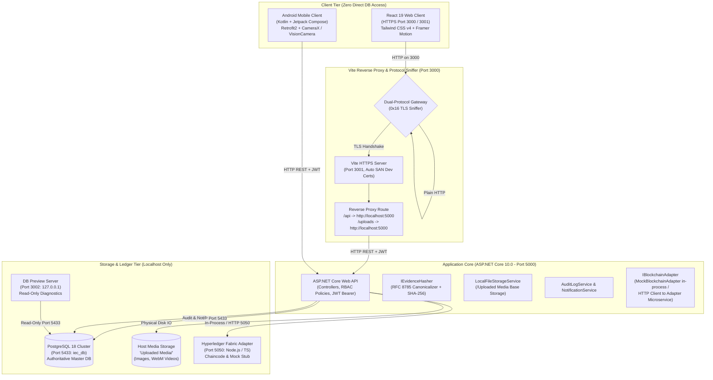
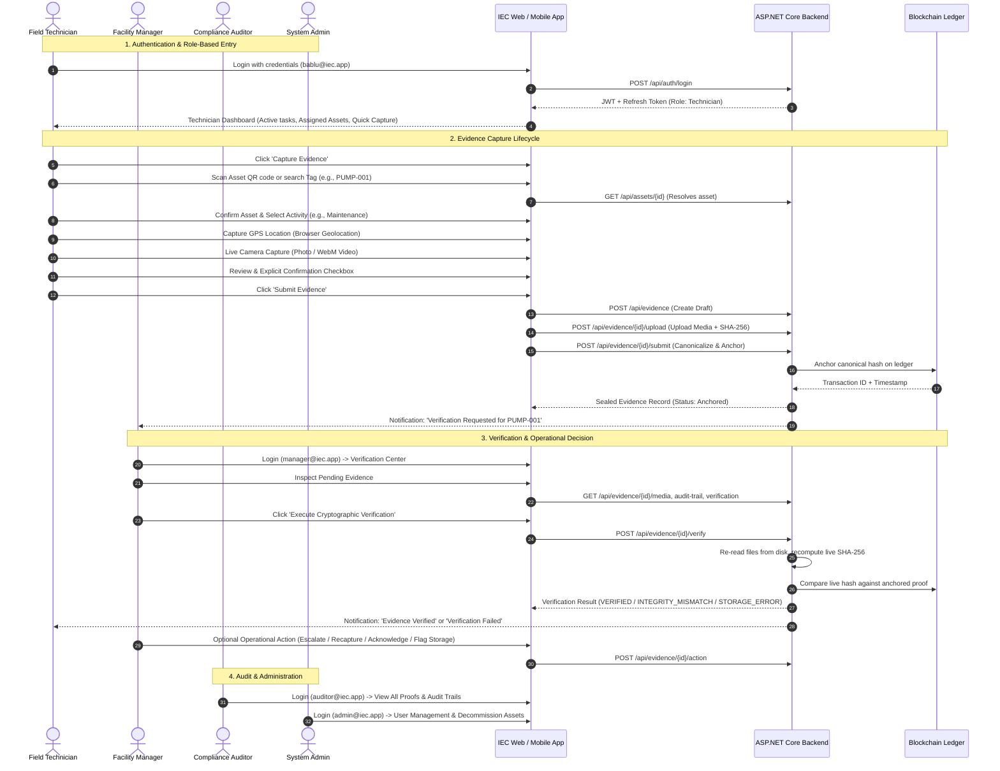

# Industrial Evidence Chain (IEC) — Complete Project Context & Architecture

**Document Version:** 1.0.0  
**Audit Date:** October 2026  
**Audited Branch:** `Testing_prot-1`  
**Repository:** `https://github.com/Pratham-dev05/Industrial-Evidence-Chain`  
**Target Environment:** macOS / Linux / Windows, .NET 10.0, Node.js, PostgreSQL 18  

---

## 1. Executive Summary & Purpose

The **Industrial Evidence Chain (IEC)** is an enterprise-grade, tamper-evident audit and evidence management system designed for mission-critical industrial environments (manufacturing plants, chemical processing facilities, refineries, utilities, and infrastructure sites).

In conventional industrial operations, field technicians record maintenance checks, safety inspections, environmental compliance reports, and incident logs through paper forms, spreadsheets, or mutable centralized web forms. These legacy methods suffer from severe vulnerabilities:
1. **Post-Incident Tampering:** Inspection records and timestamps can be modified retroactively after an industrial failure or compliance breach.
2. **Media Spoofing:** Photos or videos submitted as proof of work are frequently taken from desktop camera rolls, recycled from prior dates, or edited.
3. **Location Fraud:** Technicians can claim an inspection occurred on-site while physically located elsewhere.
4. **Lack of Cryptographic Chain of Custody:** Centralized databases allow database administrators (DBAs) or compromised backend accounts to alter records with zero cryptographic trace.
5. **Slow Operational Review:** Facility managers lack real-time visibility into incoming field logs and cannot systematically verify cryptographic evidence integrity before approving operations.

**IEC resolves these vulnerabilities** by establishing a deterministic, end-to-end evidence lifecycle:
- Assets are identified with unique physical QR codes.
- Field evidence capture is enforced via real-time camera streams (photo and video) and browser/device geolocation.
- Evidence records and binary media attachments are canonicalized using **RFC 8785 JSON Canonicalization Scheme (JCS)** and hashed with **SHA-256**.
- The resulting cryptographic digest is permanently anchored to a **Hyperledger Fabric** blockchain ledger, producing an immutable, non-repudiable proof.
- Facility managers verify evidence against live disk files and ledger proofs, triggering operational actions (Escalate, Request Re-capture, Acknowledge Mismatch, Flag Storage Issue).
- Every event is recorded in an immutable audit trail and broadcast through role-isolated notifications.

---

## 2. Core Business Problems & IEC Solutions

| Problem in Industry | Legacy Impact | IEC Technical Solution |
| :--- | :--- | :--- |
| **Asset Misidentification** | Maintenance performed on wrong valve or turbine; records misattributed. | Physical QR tags encode unique `qr_identifier` GUIDs resolved against PostgreSQL `assets`. |
| **Recycled / Edited Media** | Stale photos from camera roll submitted as proof of recent repair. | Frontend wizard enforces real-time camera/video capture directly from device media stream. |
| **Location Falsification** | "Ghost inspections" conducted remotely without visiting physical machinery. | GPS coordinates (`latitude`, `longitude`, `accuracy`) captured live at inspection time. |
| **Silent Database Modification** | DBA or insider updates record `description` or `timestamp` in database. | Live verification recalculates SHA-256 digest; mismatch flags `INTEGRITY_MISMATCH`. |
| **Media File Modification on Disk** | An image file in storage is replaced or modified. | System checks physical media SHA-256 against stored `file_hash`; flags `FILE_TAMPERED`. |
| **Storage Infrastructure Outage** | Storage drive fails or file is deleted; mistaken for malicious tampering. | System detects unreadable files and flags `STORAGE_ERROR` (`FAILED`), preserving distinct operational meaning. |
| **Audit Disputes** | Regulatory inspectors cannot verify whether maintenance actually occurred. | Blockchain transaction ID (`transaction_id`) and RFC 8785 canonical hash provide non-repudiable mathematical proof. |

---

## 3. High-Level System Architecture

The active IEC architecture consists of four tightly decoupled tiers communicating over standard secure network protocols.

### Key Architectural Boundaries & Invariants
1. **Frontend Isolation:** Neither the React web app nor the Android mobile app connects directly to PostgreSQL, Redis, or blockchain nodes. Every interaction flows through the ASP.NET Core REST API with `Authorization: Bearer <JWT>`.
2. **Database Port Authority:** The single authoritative IEC database runs on **TCP port 5433** (`iec_db` in `db_data/pgdata`). The application backend explicitly forbids and overrides any connection pointing to default port 5432.
3. **Storage Boundary:** Binary evidence media (photos, videos) are stored on the host filesystem under `Uploaded Media/` with unique GUID prefixes. PostgreSQL stores only relative storage paths, file sizes, MIME types, and binary SHA-256 hashes (`file_hash`).
4. **Blockchain Ledger Decoupling:** The backend calls `IBlockchainAdapter`. In development, `MockBlockchainAdapter` provides thread-safe, in-process ledger simulation. The companion Node.js microservice (`blockchain/src/server.ts` on port 5050) provides the exact same contract with Hyperledger Fabric chaincode (`EvidenceProofContract`).

---

## 4. End-to-End System Perspectives

### 4.1 User Perspective (Role-Based Journey)

### 4.2 Developer Perspective (Code Execution & Data Flow)

From an engineering perspective, every evidence record moves through three distinct cryptographic phases:

1. **Phase 1: Draft Creation (`POST /api/evidence`)**
   - Validates that `AssetId` exists in PostgreSQL and `UserId` is valid.
   - Validates latitude (-90 to +90) and longitude (-180 to +180).
   - Resolves `AssignedManagerId` (from request or defaults to first registered Manager).
   - Inserts row into `evidence_records` with `anchor_status = 'Pending'`, `evidence_hash = null`.
   - Inserts audit log entry (`action = 'EvidenceCreated'`).
   - Dispatches in-app notification to the assigned Manager (`type = 'VerificationRequest'`).

2. **Phase 2: Media Storage & Binary Hashing (`POST /api/evidence/{id}/media`)**
   - Stream is received via `multipart/form-data`.
   - Validates file size (max 50 MB) and extension against whitelist (`.jpg`, `.png`, `.mp4`, `.webm`, `.pdf`, etc.).
   - `LocalFileStorageService` generates a unique filename (`{guid}_{originalName}`), determines year/month subdirectories, writes bytes to disk, and computes binary SHA-256.
   - Inserts row into `evidence_media` with `storage_url`, `file_size_bytes`, and `file_hash`.
   - Inserts audit log entry (`action = 'MediaAttached'`).

3. **Phase 3: Cryptographic Canonicalization & Anchoring (`POST /api/evidence/{id}/submit`)**
   - Gathers all binary media hashes (`m.FileHash`). If missing, streams file from disk and computes live SHA-256.
   - Constructs a `CanonicalEvidencePayload` DTO:
     - `activityType` (string, NFC normalized)
     - `assetId` (lowercase 36-character hyphenated UUID)
     - `createdAt` (UTC ISO-8601 with milliseconds: `yyyy-MM-ddTHH:mm:ss.fffZ`)
     - `description` (NFC normalized string)
     - `evidenceId` (lowercase 36-character hyphenated UUID)
     - `location` (object: `latitude` and `longitude` strings fixed to 6 decimal places, e.g. `"19.076000"`)
     - `mediaReferences` (array of media SHA-256 strings in preserved order)
     - `timestamp` (UTC ISO-8601 with milliseconds: `yyyy-MM-ddTHH:mm:ss.fffZ`)
     - `userId` (lowercase 36-character hyphenated UUID)
   - Keys are sorted lexicographically by UTF-16 code units as required by **RFC 8785**.
   - Computes SHA-256 over canonical UTF-8 bytes $\rightarrow$ produces authoritative `evidence_hash`.
   - Submits hash to `IBlockchainAdapter.AnchorEvidenceAsync()`.
   - On success, updates `evidence_records.anchor_status = 'Anchored'`, creates a row in `blockchain_proofs`, and logs `action = 'EvidenceSubmitted'`.

4. **Phase 4: Cryptographic Verification (`POST /api/evidence/{id}/verify`)**
   - Streams every physical file from disk and recalculates SHA-256:
     - If a file is missing or unreadable $\rightarrow$ returns `Status = 'FAILED'`, `errorType = 'STORAGE_ERROR'`.
     - If file bytes on disk differ from stored `file_hash` $\rightarrow$ marks `physicalFileTampered = true`.
   - Reconstructs `CanonicalEvidencePayload` with live file hashes and recalculates `calculatedHash`.
   - Queries ledger via `IBlockchainAdapter.VerifyEvidenceAsync()`.
   - If physical file was modified or canonical hash differs from ledger $\rightarrow$ returns `INTEGRITY_MISMATCH`.
   - If hashes match perfectly $\rightarrow$ returns `VERIFIED`.
   - Persists verification event in `audit_logs` and sends real-time notification to the technician.

---

## 5. Technology Stack Summary

| Layer | Technology | Version | Key Libraries / Frameworks |
| :--- | :--- | :--- | :--- |
| **Web Frontend** | React / TypeScript | React 19.2.8 / TS 6.0 | React Router DOM v7, Tailwind CSS v4, Framer Motion v13, Lucide React, Axios, QRCode.react, Html5-QRCode |
| **Frontend Tooling** | Vite / Rollup | Vite 8.2.2 | `@vitejs/plugin-react`, `@tailwindcss/vite`, `@vitejs/plugin-basic-ssl`, Oxlint |
| **Backend Core** | ASP.NET Core | .NET 10.0.400 | C# 13, Npgsql.EntityFrameworkCore.PostgreSQL 9.0.4, Swashbuckle (Swagger/OpenAPI), JwtBearer |
| **Database** | PostgreSQL | 18 (Cluster) | Npgsql EF Core provider, `uuid-ossp`, `jsonb`, connection pooling |
| **Off-Chain Media** | Local Filesystem | POSIX / Win32 | `Uploaded Media/` directory, byte-range streaming for mobile video playback |
| **Blockchain Adapter** | Node.js / TypeScript | Node 20+ / TS 5.7 | Native Node `crypto`, `tsx`, `http`, Mock Chaincode Stub |
| **Smart Contract** | Fabric Chaincode | Hyperledger Fabric 2.5 spec | `fabric-contract-api` compatible contract (`evidenceContract.ts`) |
| **Mobile Client** | Kotlin / Compose | Android SDK 34+ | Jetpack Compose, Material 3, Navigation, Coroutines, StateFlow, Retrofit2, OkHttp, Coil, ZXing |
| **Database Diagnostics** | Node.js HTTP Server | Node 20+ | `pg` connection pool, read-only SQL, sensitive data redaction |

---

## 6. Document Governance

This context document serves as the top-level architectural authority for the Industrial Evidence Chain codebase. All file maps, database schemas, API references, and operations guides must adhere to the design rules established here.

