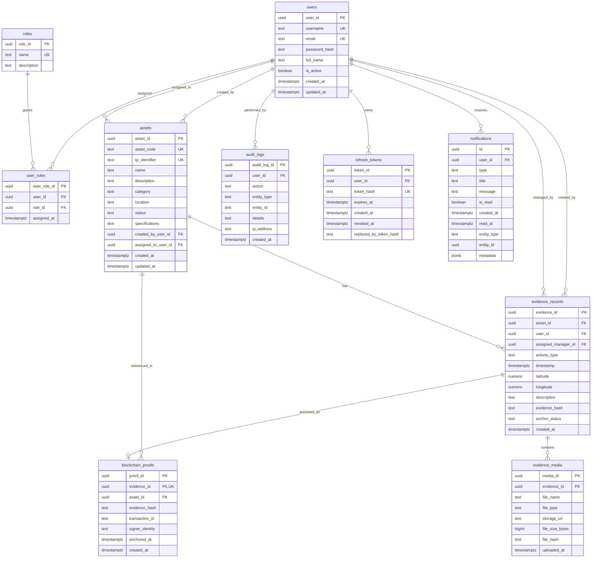

# Industrial Evidence Chain (IEC) — Database & Data Model Specification

**Document Version:** 1.0.0  
**Audit Date:** October 2026  
**Database Engine:** PostgreSQL 18.x  
**Authoritative Port:** `5433`  
**Database Name:** `iec_db`  
**ORM / Provider:** Microsoft Entity Framework Core 9.0 / Npgsql.EntityFrameworkCore.PostgreSQL  

---

## 1. Database Source of Truth & Connection Integrity

A critical architectural constraint in the IEC ecosystem is the strict distinction between PostgreSQL instances:
- **Port 5432:** Often occupied by a default operating system PostgreSQL service on developer machines.
- **Port 5433:** The **sole authoritative IEC database cluster**, physically located at `db_data/pgdata/`.

### Enforcement in Code & Scripts
1. **ASP.NET Core Backend (`Program.cs`):**
   ```csharp
   // Strictly enforce IEC Port 5433 and iec_db
   var dbHost = "localhost";
   var dbPort = "5433";
   var dbName = "iec_db";

   // Regex replaces any host/port/database in connection string with 5433 and iec_db
   resolvedConnectionString = Regex.Replace(resolvedConnectionString, @"Host=[^;]+", $"Host={dbHost}");
   resolvedConnectionString = Regex.Replace(resolvedConnectionString, @"Port=[^;]+", $"Port={dbPort}");
   resolvedConnectionString = Regex.Replace(resolvedConnectionString, @"Database=[^;]+", $"Database={dbName}");
   ```
2. **DB Preview Server (`tools/db-preview/server.js`):**
   ```javascript
   const requestedPort = parseInt(process.env.DB_PORT || '5433', 10);
   if (requestedPort !== 5433) {
     console.warn(`[IEC DB Preview] WARNING: Disallowed DB_PORT ${requestedPort} detected. IEC strictly uses Port 5433.`);
   }
   ```
3. **Startup Scripts (`start.sh` & `start.bat`):**
   Explicitly launch `pg_ctl -D db_data/pgdata -o "-p 5433" start`, test connection on port 5433, and refuse to auto-create an empty database if `iec_db` is missing, preventing accidental data loss.

---

## 2. Complete Entity-Relationship (ER) Diagram



---

## 3. Detailed Table Specifications

### 3.1 `users`
Stores registered user identities and account state.

| Column | Data Type | Nullable | Default | Constraints / Description |
| :--- | :--- | :---: | :--- | :--- |
| `user_id` | `uuid` | No | `gen_random_uuid()` | Primary Key |
| `username` | `text` | No | None | Unique (`ix_users_username`) |
| `email` | `text` | No | None | Unique (`ix_users_email`) |
| `password_hash` | `text` | No | None | PBKDF2 HMAC-SHA256 salted hash (format: `iterations.salt.hash`) |
| `full_name` | `text` | No | None | User's full legal name |
| `is_active` | `boolean` | No | `true` | Account approval flag (new self-registered accounts start `false`) |
| `created_at` | `timestamptz` | No | `CURRENT_TIMESTAMP` | Account creation timestamp |
| `updated_at` | `timestamptz` | Yes | None | Profile last updated timestamp |

### 3.2 `roles`
Stores standard system roles.

| Column | Data Type | Nullable | Default | Constraints / Description |
| :--- | :--- | :---: | :--- | :--- |
| `role_id` | `uuid` | No | `gen_random_uuid()` | Primary Key |
| `name` | `text` | No | None | Unique (`ix_roles_name`). Values: `Admin`, `Manager`, `Technician`, `Auditor` |
| `description` | `text` | Yes | None | Human-readable role description |

### 3.3 `user_roles`
Junction table mapping users to roles (many-to-many relationship).

| Column | Data Type | Nullable | Default | Constraints / Description |
| :--- | :--- | :---: | :--- | :--- |
| `user_role_id` | `uuid` | No | `gen_random_uuid()` | Primary Key |
| `user_id` | `uuid` | No | None | Foreign Key $\rightarrow$ `users.user_id` (ON DELETE CASCADE) |
| `role_id` | `uuid` | No | None | Foreign Key $\rightarrow$ `roles.role_id` (ON DELETE CASCADE) |
| `assigned_at` | `timestamptz` | No | `CURRENT_TIMESTAMP` | Timestamp role was assigned |

- **Unique Index:** `ix_user_roles_user_role` on `(user_id, role_id)` prevents duplicate role assignments.

### 3.4 `assets`
Industrial plant equipment and machinery tracked by the system.

| Column | Data Type | Nullable | Default | Constraints / Description |
| :--- | :--- | :---: | :--- | :--- |
| `asset_id` | `uuid` | No | `gen_random_uuid()` | Primary Key |
| `asset_code` | `text` | No | None | Unique (`ix_assets_asset_code`). Human-readable tag (e.g. `PUMP-001`, `TURBINE-04`) |
| `qr_identifier` | `text` | No | None | Unique (`ix_assets_qr_identifier`). Non-enumerable UUID string encoded in physical QR |
| `name` | `text` | No | None | Asset title/label |
| `description` | `text` | Yes | None | Functional description |
| `category` | `text` | No | None | Indexed (`ix_assets_category`). (e.g. `Pumps`, `Electrical`, `Piping`, `Sensors`) |
| `location` | `text` | Yes | None | JSON string storing `{ site, building, floor, room, coordinates }` |
| `status` | `text` | No | None | Indexed (`ix_assets_status`). Enum: `Active`, `Inactive`, `Maintenance`, `Retired`, `Lost`, `Decommissioned` |
| `specifications`| `text` | No | `'{}'` | JSON string storing arbitrary technical specs |
| `created_by_user_id` | `uuid` | No | None | Foreign Key $\rightarrow$ `users.user_id` (ON DELETE RESTRICT) |
| `assigned_to_user_id` | `uuid` | No | None | Foreign Key $\rightarrow$ `users.user_id` (ON DELETE RESTRICT). Indexed |
| `created_at` | `timestamptz` | No | `CURRENT_TIMESTAMP` | Creation timestamp |
| `updated_at` | `timestamptz` | Yes | None | Last update timestamp |

### 3.5 `evidence_records`
Core evidence log captured by field technicians.

| Column | Data Type | Nullable | Default | Constraints / Description |
| :--- | :--- | :---: | :--- | :--- |
| `evidence_id` | `uuid` | No | `gen_random_uuid()` | Primary Key |
| `asset_id` | `uuid` | No | None | Foreign Key $\rightarrow$ `assets.asset_id` (ON DELETE RESTRICT). Indexed |
| `user_id` | `uuid` | No | None | Foreign Key $\rightarrow$ `users.user_id` (ON DELETE RESTRICT). Indexed |
| `assigned_manager_id` | `uuid` | Yes | None | Foreign Key $\rightarrow$ `users.user_id` (ON DELETE SET NULL). Indexed |
| `activity_type`| `text` | No | None | Enum: `Maintenance`, `Inspection`, `Safety`, `Quality`, `Audit`, `Incident`, `SparePart`, `Transfer` |
| `timestamp` | `timestamptz` | No | None | Technician inspection timestamp (UTC) |
| `latitude` | `numeric(10,7)`| Yes | None | Geolocation latitude (-90.0000000 to +90.0000000) |
| `longitude` | `numeric(10,7)`| Yes | None | Geolocation longitude (-180.0000000 to +180.0000000) |
| `description` | `text` | No | None | Field inspection notes |
| `evidence_hash`| `text` | Yes | None | 64-character lowercase hex SHA-256 digest of RFC 8785 canonical JSON |
| `anchor_status`| `text` | No | None | Indexed (`ix_evidence_records_anchor_status`). Enum: `Pending`, `Anchored`, `Failed` |
| `created_at` | `timestamptz` | No | `CURRENT_TIMESTAMP` | Record creation timestamp |

### 3.6 `evidence_media`
Binary photos and videos attached to evidence records.

| Column | Data Type | Nullable | Default | Constraints / Description |
| :--- | :--- | :---: | :--- | :--- |
| `media_id` | `uuid` | No | `gen_random_uuid()` | Primary Key |
| `evidence_id` | `uuid` | No | None | Foreign Key $\rightarrow$ `evidence_records.evidence_id` (ON DELETE CASCADE). Indexed |
| `file_name` | `text` | No | None | Original uploaded filename |
| `file_type` | `text` | No | None | Enum: `Image`, `Video`, `Document` |
| `storage_url` | `text` | No | None | Relative web access URL (e.g. `/uploads/2026/09/guid_photo.jpg`) |
| `file_size_bytes` | `bigint` | Yes | None | File size in bytes |
| `file_hash` | `text` | Yes | None | 64-character hex SHA-256 checksum of raw binary file contents |
| `uploaded_at` | `timestamptz` | No | `CURRENT_TIMESTAMP` | Upload timestamp |

### 3.7 `blockchain_proofs`
Cryptographic anchoring receipts issued by the Hyperledger Fabric ledger.

| Column | Data Type | Nullable | Default | Constraints / Description |
| :--- | :--- | :---: | :--- | :--- |
| `proof_id` | `uuid` | No | `gen_random_uuid()` | Primary Key |
| `evidence_id` | `uuid` | No | None | Unique Foreign Key $\rightarrow$ `evidence_records.evidence_id` (ON DELETE RESTRICT). One-to-one |
| `asset_id` | `uuid` | No | None | Foreign Key $\rightarrow$ `assets.asset_id` (ON DELETE RESTRICT) |
| `evidence_hash`| `text` | No | None | The exact canonical SHA-256 digest committed to the ledger |
| `transaction_id`| `text` | No | None | Indexed (`ix_blockchain_proofs_transaction_id`). Hyperledger Fabric transaction identifier |
| `signer_identity`| `text` | Yes | None | X.509 certificate subject or user identity of committer |
| `anchored_at` | `timestamptz` | No | None | Ledger commit block timestamp |
| `created_at` | `timestamptz` | No | `CURRENT_TIMESTAMP` | Record creation timestamp |

### 3.8 `audit_logs`
Append-only system audit log tracking all operational and verification events.

| Column | Data Type | Nullable | Default | Constraints / Description |
| :--- | :--- | :---: | :--- | :--- |
| `audit_log_id`| `uuid` | No | `gen_random_uuid()` | Primary Key |
| `user_id` | `uuid` | Yes | None | Foreign Key $\rightarrow$ `users.user_id` (ON DELETE SET NULL). Preserves logs if user deleted |
| `action` | `text` | No | None | Action identifier (e.g. `EvidenceCreated`, `MediaAttached`, `EvidenceSubmitted`, `EvidenceVerified`, `EvidenceEscalated`, `UserStatusUpdated`) |
| `entity_type` | `text` | Yes | None | Indexed (`ix_audit_logs_entity_type`). (e.g. `EvidenceRecord`, `Asset`, `User`) |
| `entity_id` | `text` | Yes | None | Target entity UUID string |
| `details` | `text` | Yes | None | Structured JSON details of the event |
| `ip_address` | `text` | Yes | None | Client IP address |
| `created_at` | `timestamptz` | No | `CURRENT_TIMESTAMP` | Indexed (`ix_audit_logs_created_at`). Event timestamp |

### 3.9 `refresh_tokens`
Cryptographically hashed refresh tokens supporting JWT rotation and replay detection.

| Column | Data Type | Nullable | Default | Constraints / Description |
| :--- | :--- | :---: | :--- | :--- |
| `token_id` | `uuid` | No | `gen_random_uuid()` | Primary Key |
| `user_id` | `uuid` | No | None | Foreign Key $\rightarrow$ `users.user_id` (ON DELETE CASCADE). Indexed |
| `token_hash` | `text` | No | None | Unique (`ix_refresh_tokens_token_hash`). SHA-256 hash of refresh token string |
| `expires_at` | `timestamptz` | No | None | Absolute expiration date (typically 7 days) |
| `created_at` | `timestamptz` | No | `CURRENT_TIMESTAMP` | Generation timestamp |
| `revoked_at` | `timestamptz` | Yes | None | Revocation timestamp if logged out or rotated |
| `replaced_by_token_hash` | `text` | Yes | None | Token hash that succeeded this token (used for replay detection) |

### 3.10 `notifications`
Real-time user alerts and task notifications.

| Column | Data Type | Nullable | Default | Constraints / Description |
| :--- | :--- | :---: | :--- | :--- |
| `id` | `uuid` | No | `gen_random_uuid()` | Primary Key |
| `user_id` | `uuid` | No | None | Foreign Key $\rightarrow$ `users.user_id` (ON DELETE CASCADE). Indexed (`ix_notifications_user_id`) |
| `type` | `text` | No | None | Event type: `VerificationRequest`, `EvidenceVerified`, `VerificationFailed`, `AssetAssigned`, `UserApproved` |
| `title` | `text` | No | None | Alert headline |
| `message` | `text` | No | None | Detailed notification message |
| `is_read` | `boolean` | No | `false` | Indexed (`ix_notifications_is_read`). Read flag |
| `created_at` | `timestamptz` | No | `CURRENT_TIMESTAMP` | Notification timestamp |
| `read_at` | `timestamptz` | Yes | None | Timestamp marked read |
| `entity_type` | `text` | Yes | None | Associated entity (`EvidenceRecord`, `Asset`, `User`) |
| `entity_id` | `uuid` | Yes | None | Associated entity GUID |
| `metadata` | `jsonb` | Yes | None | Extra JSON payload |

---

## 4. EF Core Migrations History

The migrations table (`__EFMigrationsHistory`) records all applied schema changes:

1. `20260905132718_InitialCreate`: Core tables (`users`, `roles`, `user_roles`, `assets`, `evidence_records`, `evidence_media`, `blockchain_proofs`, `audit_logs`).
2. `20260907120000_AddFileHashToEvidenceMedia`: Adds `file_hash` column to `evidence_media` for physical media tampering detection.
3. `20260907130000_AddRefreshTokenTable`: Adds `refresh_tokens` table for JWT session lifecycle and token rotation.
4. `20260924043434_AddQrIdentifierAndNotifications`: Adds `qr_identifier` text column with unique index to `assets`, backfills existing records, and creates the `notifications` table.

---

## 5. Seed Data & Default Development Credentials

When the backend initializes against a fresh or running `iec_db`, `DbInitializer.SeedAsync()` automatically seeds the four fundamental roles and default development accounts:

| Role | Username | Email | Full Name | Default Password |
| :--- | :--- | :--- | :--- | :--- |
| **Admin** | `admin` | `admin@iec.app` | Admin User | `password123` |
| **Technician** | `tech` | `tech@iec.app` | John Smith | `password123` |
| **Manager** | `manager` | `manager@iec.app` | Sarah Connor | `password123` |
| **Auditor** | `auditor` | `auditor@iec.app` | Michael Chen | `password123` |

> [!NOTE]
> All passwords in the database are hashed with PBKDF2 using 10,000 iterations of HMAC-SHA256 and a cryptographically secure 128-bit random salt. Plaintext passwords are never stored.

