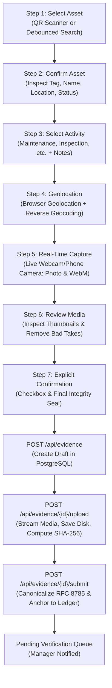
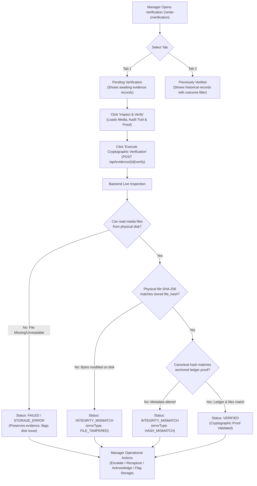
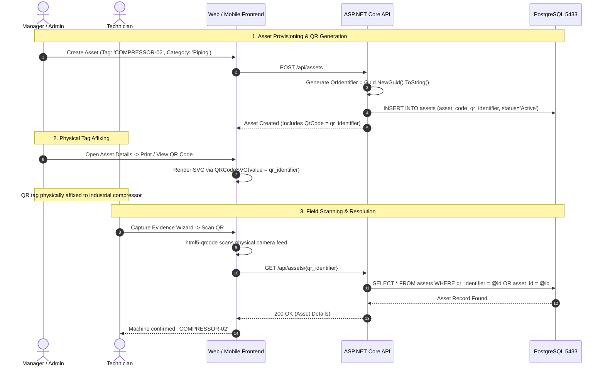

# Industrial Evidence Chain (IEC) — Workflows & Role-Based Access Control (RBAC)

**Document Version:** 1.0.0  
**Audit Date:** October 2026  
**Audited Branch:** `Testing_prot-1`  

---

## 1. Roles & Permissions Matrix

IEC establishes four distinct operational roles. Security is enforced through **defense-in-depth**: frontend route guards and UI button visibility are paired with strict ASP.NET Core backend authorization attributes and policies.

### 1.1 RBAC Enforcement Matrix

| Feature / Action | Technician | Manager | Auditor | Admin | Backend Policy / Enforcement |
| :--- | :---: | :---: | :---: | :---: | :--- |
| **Login / Session Refresh** | Allowed | Allowed | Allowed | Allowed | `AllowAnonymous` on `/api/auth/login`, `/api/auth/refresh` |
| **Self Profile Update** | Allowed | Allowed | Allowed | Allowed | `Authorize` on `/api/users/{id}` (Must match `sub` claim) |
| **View Assigned Dashboard** | Technician | Manager | Auditor | Admin | Handled by `DashboardPage.tsx` based on `user.role` |
| **Search & View Assets** | Read-Only | Read-Only | Read-Only | Full Access | `Authorize` on `GET /api/assets`, `GET /api/assets/{id}` |
| **Create New Asset** | Hidden | Allowed | Hidden | Allowed | `RequireManager` policy (`RequireRole("Manager", "Admin")`) |
| **Update Asset Metadata** | Hidden | Allowed | Hidden | Allowed | `RequireManager` policy (`RequireRole("Manager", "Admin")`) |
| **Soft-Decommission Asset** | Hidden | Hidden | Hidden | Allowed | `Authorize(Roles = "Admin")` on `DELETE /api/assets/{id}` |
| **View Asset History** | Allowed | Allowed | Allowed | Allowed | `Authorize` on `GET /api/assets/{id}/history` |
| **Capture Evidence Wizard** | Full Access | Allowed | Hidden | Allowed | `RequireEvidenceCreator` policy (`Tech, Manager, Admin`) |
| **Upload Evidence Media** | Full Access | Allowed | Hidden | Allowed | `RequireEvidenceCreator` on `POST /api/evidence/{id}/media` |
| **Submit / Anchor Evidence** | Full Access | Allowed | Hidden | Allowed | `RequireEvidenceCreator` on `POST /api/evidence/{id}/submit` |
| **View Full Blockchain Hash** | Masked | Full Hex | Full Hex | Full Hex | Backend `ApplyHashMasking()` masks hash for Technicians |
| **Access Verification Center**| Forbidden | Full Access | Read-Only | Full Access | `RoleRoute` in frontend; `Roles = "Manager,Auditor,Admin"` |
| **Trigger Cryptographic Verify**| Forbidden | Allowed | Allowed | Allowed | `Authorize(Roles = "Manager,Auditor,Admin")` on `/verify` |
| **Perform Operational Action** | Forbidden | Allowed | Hidden | Allowed | `Authorize(Roles = "Manager,Admin")` on `/action` |
| **View System Audit Logs** | Forbidden | Forbidden | Forbidden | Allowed | `RequireAdmin` policy on `GET /api/admin/audit` |
| **Approve / Deactivate Users** | Forbidden | Forbidden | Forbidden | Allowed | `RequireAdmin` policy on `PATCH /api/admin/users/{id}/status` |

---

## 2. Technician Workflow: Complete Evidence Lifecycle

The Technician evidence collection workflow is implemented as a strict, guided **7-step wizard** in `frontend/src/pages/technician/evidence/CaptureEvidencePage.tsx`.

### Step-by-Step Breakdown

#### Step 1: Select Target Asset
- **User Action:** Technician can click **Scan Asset QR** or enter text in the search bar.
- **QR Scanner:** Uses `html5-qrcode` via `QRScanner.tsx`. When a physical QR is detected, `handleQRScan()` parses the raw QR text (supporting plain GUIDs, asset tags, or URLs like `https://iec.app/assets/{id}`) via `parseAssetIdentifier()`.
- **Search Option:** Queries `assetService.getAssets({ query, pageSize: 8 })` with debouncing (300ms).
- **Backend Call:** `GET /api/assets/{id}` resolves the asset whether passed its `asset_id` or its `qr_identifier`.

#### Step 2: Confirm Asset Details
- **User Action:** Displays asset card showing `AssetTag`, `Name`, `Category`, `Location`, and `Status`. Technician verifies machinery in front of them and clicks **Confirm & Continue**.

#### Step 3: Select Activity & Description
- **Activity Types (8):** `Maintenance`, `Inspection`, `Safety`, `Quality`, `Audit`, `Incident`, `SparePart`, `Transfer`.
- **Timestamp:** Locked to client current time (`new Date()`).
- **Description:** Mandatory text input describing the physical inspection or repair.

#### Step 4: Capture Live GPS Coordinates
- **User Action:** Technician clicks **Capture Current Location**.
- **Browser API:** Calls `navigator.geolocation.getCurrentPosition({ enableHighAccuracy: true, timeout: 10000 })`.
- **Reverse Geocoding:** Attempts reverse geocoding via OpenStreetMap Nominatim for human-readable facility address; falls back to raw coordinate string `Industrial Site (lat, lon)`.
- **Validation:** Latitude (-90 to +90) and Longitude (-180 to +180).

#### Step 5: Real-Time Camera & Video Capture
- **Hardware Enforcement:** Live video stream initiated via `navigator.mediaDevices.getUserMedia()`.
- **Photo Capture:** Canvas captures high-resolution snapshot from video stream $\rightarrow$ generates JPEG `File` object (`photo_{timestamp}.jpg`).
- **Video Capture:** `MediaRecorder` captures audio/video stream $\rightarrow$ generates WebM `File` object (`video_{timestamp}.webm`).
- **Strict Rule:** **Camera-only.** The UI contains no generic desktop file upload input in Step 5, ensuring all evidence originates directly from the camera sensor at inspection time.

#### Step 6: Review Evidence & Media
- **User Action:** Technician inspects captured thumbnails. Bad takes can be deleted via the trash icon.
- **Validation:** At least one media attachment is required to proceed.

#### Step 7: Explicit Confirmation & Submission Pipeline
- **User Action:** Technician must check the legal confirmation box:
  > *"I hereby confirm under penalty of audit sanction that this evidence was captured in real-time at the stated location and machinery."*
- **Execution Pipeline (Automatic 3-Step Execution):**
  1. **Draft Creation:** `POST /api/evidence` $\rightarrow$ creates draft in `evidence_records` (`anchor_status = 'Pending'`).
  2. **Media Upload:** `POST /api/evidence/{id}/upload` $\rightarrow$ streams binary files to `Uploaded Media/`, computes live binary SHA-256 (`file_hash`), inserts rows into `evidence_media`.
  3. **Ledger Anchoring:** `POST /api/evidence/{id}/submit` $\rightarrow$ constructs RFC 8785 canonical JSON payload with all media hashes, computes overall canonical SHA-256, calls `IBlockchainAdapter.AnchorEvidenceAsync()`, creates `blockchain_proofs` record, updates `anchor_status = 'Anchored'`.
- **Outcome:** Technician is redirected to `EvidenceDetailsPage` (`/evidence/{id}`). An automated notification is sent to the assigned Manager.

---

## 3. Manager Verification Workflow

The Manager Verification Center is implemented in `frontend/src/pages/verification/VerificationPage.tsx`.

### 3.1 Verification States & Semantics

| Verification Status | Meaning & Root Cause | Audit Log Action |
| :--- | :--- | :--- |
| `WAITING_FOR_VERIFICATION` / `PENDING_VERIFICATION` | Evidence was anchored on blockchain but has not yet undergone live manager verification. | Initial state after submission. |
| `VERIFIED` | Physical media on disk and database metadata match the anchored blockchain ledger proof with 100% mathematical fidelity. | `EvidenceVerified` (`status = 'VERIFIED'`) |
| `INTEGRITY_MISMATCH` | Cryptographic tampering detected! Either database fields (timestamp, description, coordinates) were modified post-anchoring, or binary media bytes on disk were altered. | `EvidenceVerified` (`status = 'INTEGRITY_MISMATCH'`) |
| `STORAGE_ERROR` (`FAILED`) | Physical media file is missing, deleted, or unreadable due to filesystem corruption or drive failure. **Crucial Distinction:** Not treated as intentional tampering. | `EvidenceVerified` (`errorType = 'STORAGE_ERROR'`) |
| `NOT_ANCHORED` / `PENDING` | Evidence draft was created but has not been anchored to the blockchain ledger yet. | Initial draft state. |

### 3.2 Operational Decision Actions

When a manager inspects an evidence record, especially one resulting in `INTEGRITY_MISMATCH` or `STORAGE_ERROR`, the manager can trigger formal operational actions (`POST /api/evidence/{id}/action`):

1. **Escalate (`ESCALATE`):** Escalates incident to Security Operations and Facility Leadership. Logs `action = 'EvidenceEscalated'`.
2. **Request Re-capture (`REQUEST_RECAPTURE`):** Flags record and dispatches a notification to the field technician to recapture evidence. Logs `action = 'EvidenceRecaptureRequested'`.
3. **Acknowledge Mismatch (`ACKNOWLEDGE_MISMATCH`):** Formally acknowledges the discrepancy for legal/incident review without approving. Logs `action = 'EvidenceMismatchAcknowledged'`.
4. **Flag Storage Issue (`FLAG_STORAGE_ISSUE`):** Files an IT infrastructure incident report for missing/unreadable storage files. Logs `action = 'EvidenceStorageIssueFlagged'`.

Every action requires an optional or mandatory `reason` text and is permanently recorded in `audit_logs`.

---

## 4. Asset Lifecycle & Unique QR Codes

### QR Security & Resolution Rules
- **Non-Enumerable Identification:** The QR code encodes `qr_identifier` (a random UUID), not sequential internal database keys. This prevents unauthorized users from guessing other assets.
- **No Sensitive Data Inside QR:** Physical QR codes do not encode internal credentials, passwords, or technician details.
- **Logged-Out Scanning:** If a phone scans the QR code outside the authenticated app, it resolves to `https://<HOST-IP>:3000/assets/{id}`. The app's `ProtectedRoute` intercepts the request and redirects to `/login`, preserving the return URL so the asset opens immediately upon authentication.
- **Decommissioned Asset Scanning:** If a technician scans a decommissioned asset, the backend returns the asset with `status = 'Decommissioned'`. The frontend displays a warning badge, preventing new evidence capture on retired equipment.

---

## 5. Notification System Architecture

Notifications are managed through a database-backed, role-isolated event engine.

### 5.1 Business Events Triggering Notifications

| Business Event | Trigger Source | Recipient | Notification Type | Headline |
| :--- | :--- | :--- | :--- | :--- |
| **New Evidence Draft Created** | `EvidenceService.CreateEvidenceAsync` | Assigned Manager | `VerificationRequest` | *"Verification Requested for asset {name}"* |
| **Evidence Verified by Manager** | `EvidenceService.VerifyEvidenceAsync` | Field Technician | `EvidenceVerified` | *"Evidence #{id} was successfully verified and anchored."* |
| **Verification Failed / Tampered** | `EvidenceService.VerifyEvidenceAsync` | Field Technician | `VerificationFailed` | *"Verification failed for evidence #{id}: {error}"* |
| **Asset Assigned to Technician** | `AssetService.CreateAssetAsync` | Assigned Technician| `AssetAssigned` | *"You have been assigned to a new asset: {name}"* |
| **User Account Approved** | `AdminService.UpdateUserStatusAsync` | Registered User | `UserApproved` | *"Your IEC account has been approved by an administrator."* |

### 5.2 Strict Per-User Isolation
- In PostgreSQL, every row in `notifications` contains a foreign key `user_id`.
- `GET /api/notifications` strictly queries `Where(n => n.UserId == currentUserId)`.
- In the frontend `notificationService.ts`, cached notifications are filtered by `recipientId === userId`. Switching user accounts or logging out immediately clears cached notifications, preventing data bleed between sessions.

